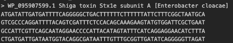
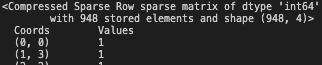
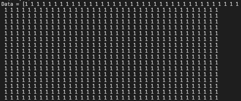
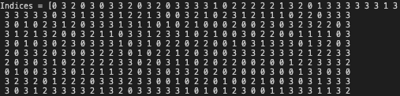
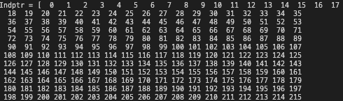
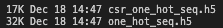

#  Compressed Sparse Row (CSR) Matrix

CSR is a very efficient way to store sparse matrices, such as one-hot vectors commonly found in machine learning tasks. This example compares the shiga toxin (Accession WP_095907599) one-hot encoded vector with a CSR matrix.


## Prerequisite

* SciPy
* Numpy
* h5py
* Bio (optional)


## Installation

```sh
pip install numpy
pip install scipy
pip install h5py
pip install biopython
```

## Usage

0. Load libraries and dependencies

    ```python
    import sys
    import numpy as np
    from scipy.sparse import csr_matrix
    from Bio import SeqIO
    import h5py as h5
    ```

    Let's also define some housekeeping variables
    
    ```python
    nucleotides = ['A', 'C', 'G', 'T']
    ```

1. Define a functions for one-hot encoding a sequence of nucleotides

    ```python
    def one_hot_naive(seq):
        #naive implementation
        arr = []
        for s in seq:
            row = [0]*4
            if s in nucleotides:
                row[nucleotides.index(s)] = 1
            arr.append(row)
        return np.array(arr)
    ```

    The above is a naive implementation, but it's not very pythonic nor efficient. Let's use a better one.

    ```python
    def one_hot(seq):
        #more efficient implementation
        arr = np.zeros((len(seq), 4), dtype=int)
        for i, s in enumerate(seq):
            if s in nucleotides:
                arr[i, nucleotides.index(s)] = 1
        return arr
    ```

2. Load a nucleotide sequence 

    ```python
    fastafile = "./stx1e_a.fna" #assuming you have a file called stx1e_a.fna in the same directory
    seq = []
    with open(fastafile, "r") as readfile:
        for record in SeqIO.parse(readfile, "fasta"):
            seq.append(str(record.seq))
    seq = seq[0] #we only have a single sequence, so this changes the list back to a string
    ```

    

    OR

    You could just hard code it into the script

    ```python
    #seq = 'ATGC...'
    ```

    The length of the sequence is 948 nucleotides.

3. One hot encode the sequence

    ```python
    one_hot_seq = one_hot(seq)
    one_hot_seq_naive = one_hot_naive(seq)
    ```

    We could check if both encoded sequences is the same
    
    ```python
    assert np.array_equal(one_hot_seq, one_hot_seq_naive)
    ```

    Nothing comes out when we run this, so both methods are one and the same.

4. CSR

    To invoke csr compression, simply use the `csr_matrix()` function. Note that we want to compress the *one-hot vector*.

    ```python
    csr_one_hot_seq = csr_matrix(one_hot_seq)
    ```
    
    This will return a csr object, containing differnt attributes.

    ```python
    print(csr_one_hot_seq)
    ```
    

    To access the data. We need to use `data`, `indices`, and `indptr` attributes.

    ```python
    print(f"Data = {csr_one_hot_seq.data}, dtype = {type(csr_one_hot_seq.data)}")
    print(f"Indices = {csr_one_hot_seq.indices}, dtype = {type(csr_one_hot_seq.indices)}")
    print(f"Indptr = {csr_one_hot_seq.indptr},  dtype = {type(csr_one_hot_seq.indptr)}")
    ```
    You will notice that all attributes are simply arrays.

    The data attribute represents the actual "stuff" in the matrix, in this case, it's all `1`s because we are simply using one-hot encoding.

    

    The indicies represent the position of the data in the matrix, in this case, it's the index of the nucleotide in the sequence. Refer to the `nucleotides` list for the actual nucleotide.

    

    The indptr attribute respresnts the mapping of data to the indicies. In this case, it's a simple incremental array as each row only has 1 single non-zero value. 

    
    
    In cases where more than 1 column has non-zero values, the indptr may have duplicate indicies in the array.

5. Compare array sizes

    We can compare the array byte size using `sys.getsizeof()`

    ```python
    print(sys.getsizeof(one_hot_seq_naive))
    # 30464 bytes
    csr_size = (sys.getsizeof(csr_one_hot_seq.data) +
            sys.getsizeof(csr_one_hot_seq.indices) +
            sys.getsizeof(csr_one_hot_seq.indptr))
    print(csr_size)
    # 4132 bytes
    ```

    We can also save these arrays into files to compare actual disk usage.

    ```python
    with h5.File("csr_one_hot_seq.h5", "w") as f:
        f.create_dataset("data", data=csr_one_hot_seq.data)
        f.create_dataset("indices", data=csr_one_hot_seq.indices)
        f.create_dataset("indptr", data=csr_one_hot_seq.indptr)
        
    with h5.File("one_hot_seq.h5", "w") as f:
        f.create_dataset("one_hot", data=one_hot_seq)
    ```

    

    CSR compression saves about ~50% in size.


6. To regenerate the one-hot encoded sequence

    To use the 3 arrays to regenerate the original one-hot encoded sequence, we can use the `csr_matrix` function again.

    ```python
    one_hot_seq_regen = csr_matrix((csr_one_hot_seq.data, csr_one_hot_seq.indices, csr_one_hot_seq.indptr))
    one_hot_seq_regen = one_hot_seq_regen.toarray() #this is important to convert to a numpy array
    assert np.array_equal(one_hot_seq_regen, one_hot_seq)
    ```

    Nothing comes out so the one-hot vector has successfully been regenerated.


# References

1. https://docs.scipy.org/doc/scipy/reference/generated/scipy.sparse.csr_matrix.html

[back](../)