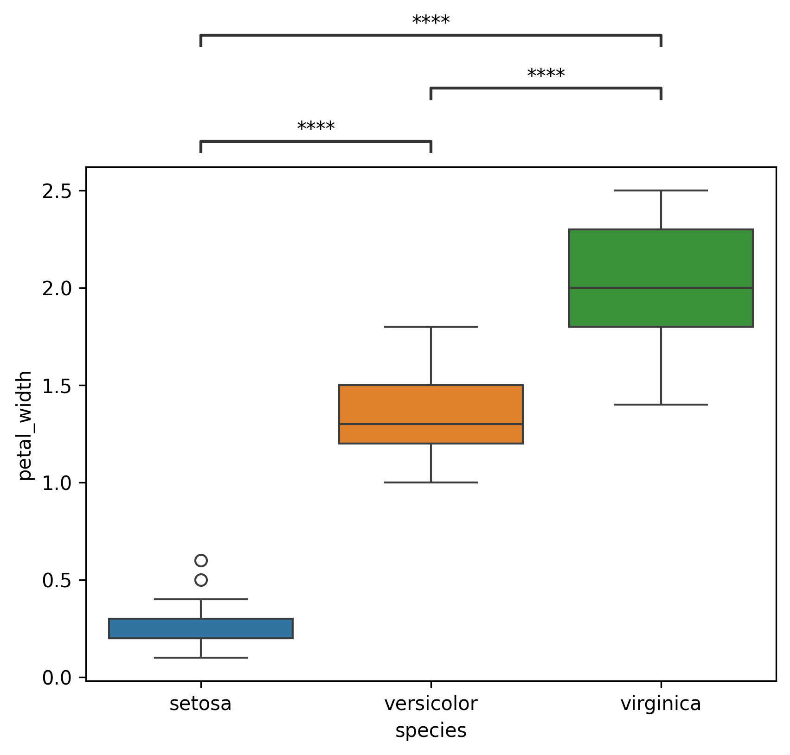
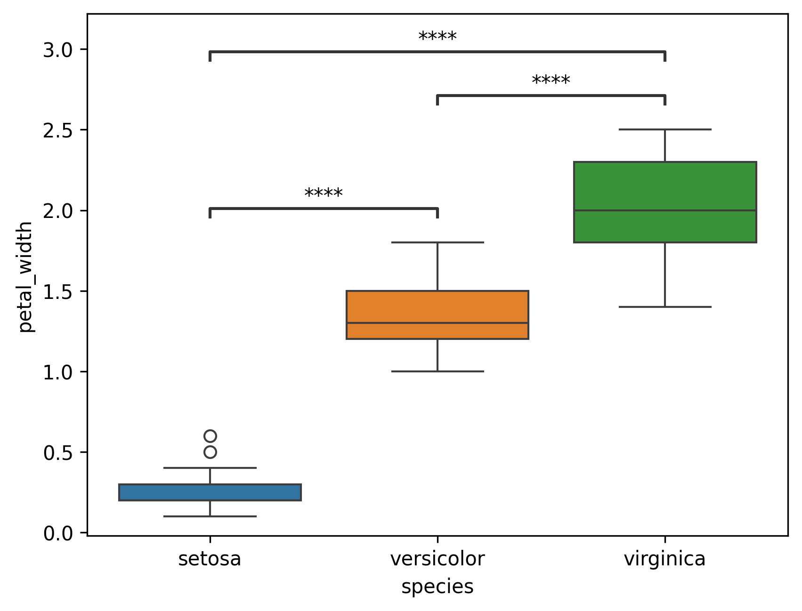

# Statistic annotations with python

> "Look what they need to mimic a fraction of our power."

When we plot graphs comparing quantitative metrics between groups, we often need to add statistical annotations to the plot to denote differences between groups. While programs such as GraphPad Prism and SPSS has built-in tools to add statistical annotations, they lack flexibility and customisability.

This post will introduce programmatic statistical annotations using Python via the `statannotations` package, using the `iris` dataset


## Prerequisite

* Python >= 3.8
* matplotlib
* seaborn
* statannotations

## Installation

```sh
pip install statannotations
```
OR

```sh
conda install -c conda-forge statannotations
```

## Usage

0. Import packages and load data
    ```python
    import matplotlib.pyplot as plt
    import seaborn as sns
    from statannotations.Annotator import Annotator #this is statannotations
    from itertools import pairwise, permutations, combinations
    df = sns.load_dataset("iris")
    ```

1. Set the x and y variables, order and combinations of comparisons
    ```python
    x = "species"
    y = "petal_width"
    order = ['setosa', 'versicolor', 'virginica']
    combo = [(x, y) for x, y in combinations(order, 2)]
    ```

    In this case we want to do a pair-wise comparison between `setosa`, `versicolor` and `virginica`

2. Initialise the plot
    ```python
    ax = sns.boxplot(data=df, x=x, y=y, hue=x, order=order, hue_order=order)
    ```

3. Initalise the annotator object

    The annotator takes your plot object, comparison comaprisons, dataset, x and y variables, and order

    ```python
    annot = Annotator(ax, combo, data=df, x=x, y=y, order=order)
    ```

4. Configure and apply the test statistic

    ```python
    annot.configure(test='Mann-Whitney', comparisons_correction="Bonferroni", text_format='star', loc='outside', verbose=2)

    annot.apply_test()
    ```

5. Annotate the plot

    ```python
    ax, test_results = annot.annotate()
    plt.show()
    ```


    The `loc` parameter controls how the annotations are placed, `outside` means they are placed outside the plot, while `inside` means they are placed inside the plot

    Outside (`loc='outside'`)
    

    Inside (`loc='inside'`)
    

6. Alternatively, the plotting can be done using a config dictionary

    Set a config dictionary
    ```python
    plotting = {
    "data": df,
    "x": x,
    "y": y,
    "hue": x,
    "hue_order": order,
    "order": order
    }
    ```

    Plotting
    ```python
    ax = sns.boxplot(**plotting)
    ```

    Configure annotation + multiple tests
    ```python
    annot.new_plot(ax, **plotting)
    annot.configure(comparisons_correction="Bonferroni", verbose=2)
    ```

    Apply test and annotate (You can daisy-chain the functions)
    ```python
    test_results = annot.apply_test().annotate()
    ```

# Reference

1. https://github.com/trevismd/statannotations

[back](../)