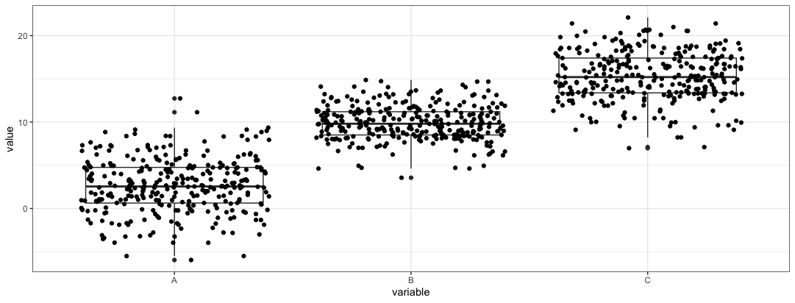
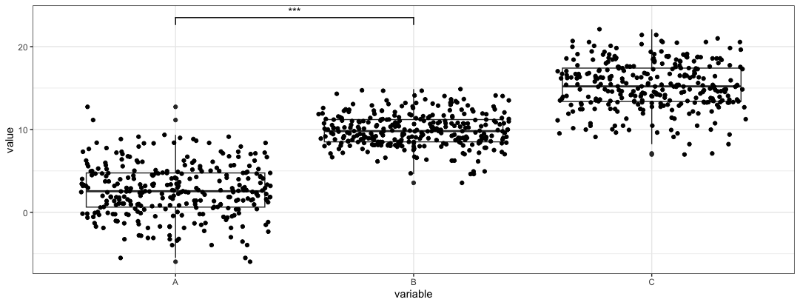
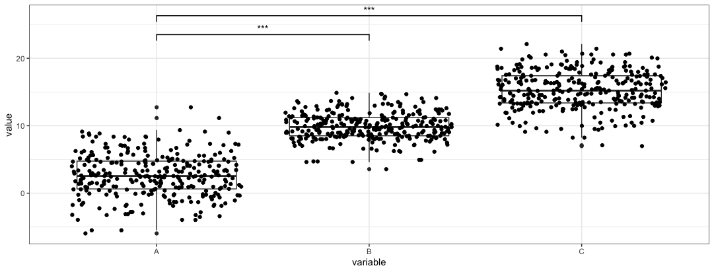
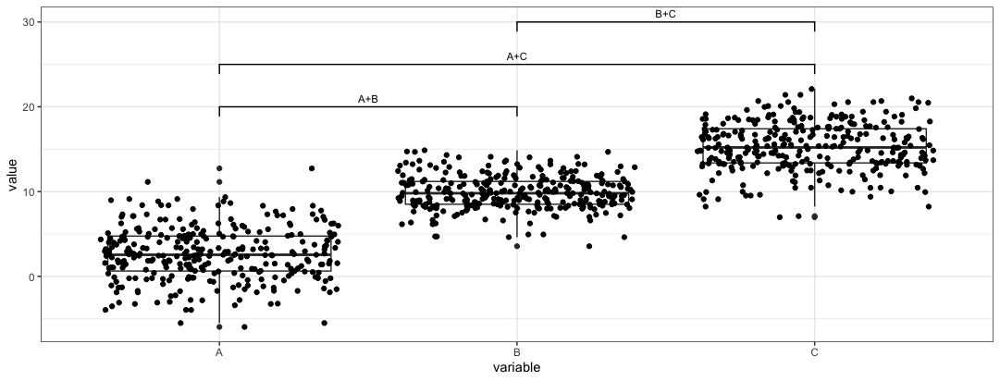
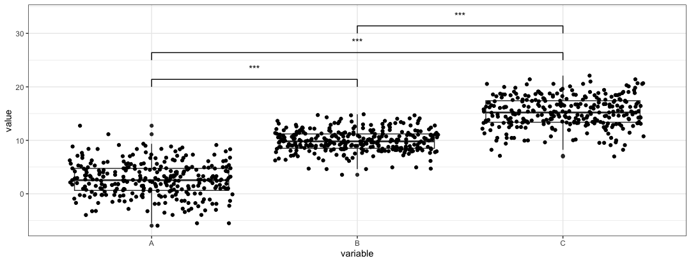
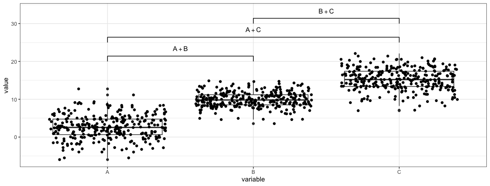

# Statistic annotations with R

> "UNLIMITED POWERRRRR"

When we plot graphs comparing quantitative metrics between groups, we often need to add statistical annotations to the plot to denote differences between groups. While programs such as GraphPad Prism and SPSS has built-in tools to add statistical annotations, they lack flexibility and customisability.

This post will introduce programmatic statistical annotations using R via the `ggpval` and `ggsignif` package.

## Prerequisite

* R
* R library `ggplot2` and `data.table`

## Installation

```R
install.packages("ggpval")
install.packages("ggsignif")
```

## Usage

0. Load libraries
    ```R
    library(data.table)
    library(ggplot2)
    library(ggpval)
    library(ggsignif)
    ```

1. Load some random data. In this case we will be using random normal data.
    ```R
    A <- rnorm(200, 3, 3)
    B <- rnorm(200, 10, 2)
    C <- rnorm(200, 15, 3)
    G <- rep(c("G1", "G2", "G3"), each = 100)
    dt <- data.table(A, B, C, G)
    dt2 <- melt(dt, id.vars =   "G")
    ```
    
    We have 3 groups of random normal data. Each group has 200 "observations", with a mean of 3, 10, and 15 respectively, and a standard deviation of 3, 2, and 3 respectively.

2. Create a simple boxplot + jitterplot. This will act as the "base" layer in which annotations will be added.
    ```R
    plt <- ggplot(dt2, aes(variable, value)) +
    geom_boxplot() +
    geom_jitter() +
    theme_bw()
    ```

    

3. Now we can layer a geom_signif object to the `plt` object

    ```R
    plt2 <- plt + geom_signif(comparisons = list(c("A", "B")),
                          map_signif_level = TRUE)
    ```

    

    The `comparisons` parameter is a list of vectors that specify the groups that you want to compare. In this case, groups `A` and `B` are compared. 

    The `map_signif_level` toggles a p-value or p-value stars are placed on the bar.

4. In comparisons of more than 2 groups

    ```R
    plt3 <- plt + geom_signif(comparisons = list(c("A", "B"), c("A", "C")),
                              map_signif_level = TRUE,
                              step_increase = 0.1)
    ```

    

    In this case we add `step_increase` parameter to preven the bars from overlapping. This example we only compare `A` and `B`, and `A` and `C`.

5. In cases where we want to control what to plot on the bars. We can create a dataframe where the labels and locations are mapped. This allows for better control of the plot.

    ```R
    anno <- data.frame(
    start = c("A", "A", "B"),
    end = c("B", "C", "C"),
    label = c("A+B", "A+C", "B+C"),
    y = c(20, 25, 30))
    ```

    Once we have the annotation dataframe, we can parse the dataframe into `ggsignif` object.

    ```R
    plt4 <- plt + geom_signif(data = anno,  
                          aes(xmin = start, xmax = end, annotations = label, y_position = y),
                          textsize = 3, vjust = -0.2,
                          manual = TRUE)
    ```

    We need to toggle the `manual` parameter to trigger this function. The aes function species where the annotations should be placed.

    

6. Alternatively, the `ggpval` packages produces similar plots. Here we regenerate the first plot

    ```R
    add_pval(plt, pairs = list(c(1,2), c(1,3), c(2,3)), heights = c(20,25,30), pval_text_adj = 2, pval_star = TRUE)
    ```

    

    We need to use the `heights` parameter to control where the pval are placed. The `pairs` parameter works similarly to the `comparisons` parameter, but loads the index instead of calling the name of the group.

7. For manual control in `ggpval` 

    ```R
    add_pval(plt, pairs = list(c(1,2), c(1,3), c(2,3)), heights = c(20,25,30), annotation = c("A+B", "A+C", "B+C"), pval_text_adj = 2)
    ```
    
    


> _**Note**_: The annotations produced by these two packages seems not to account for multiple comparisons in the same plot. No multi comparison adjustments to the pvalue (e.g. Bonferroni correction) to prevent type I error is done.

# Reference

1. https://const-ae.github.io/ggsignif/
2. https://cran.r-project.org/web/packages/ggpval/vignettes/ggpval.html

[back](../)